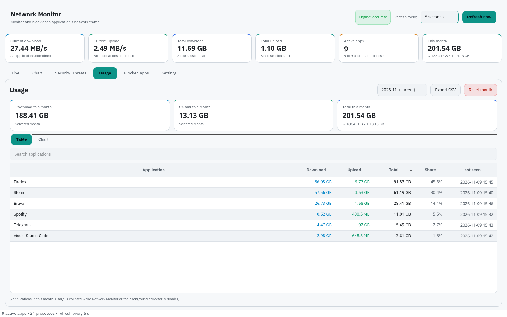
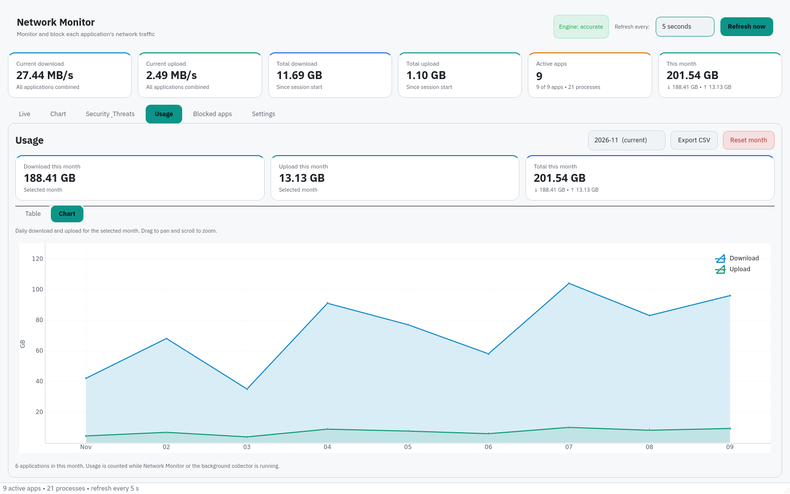
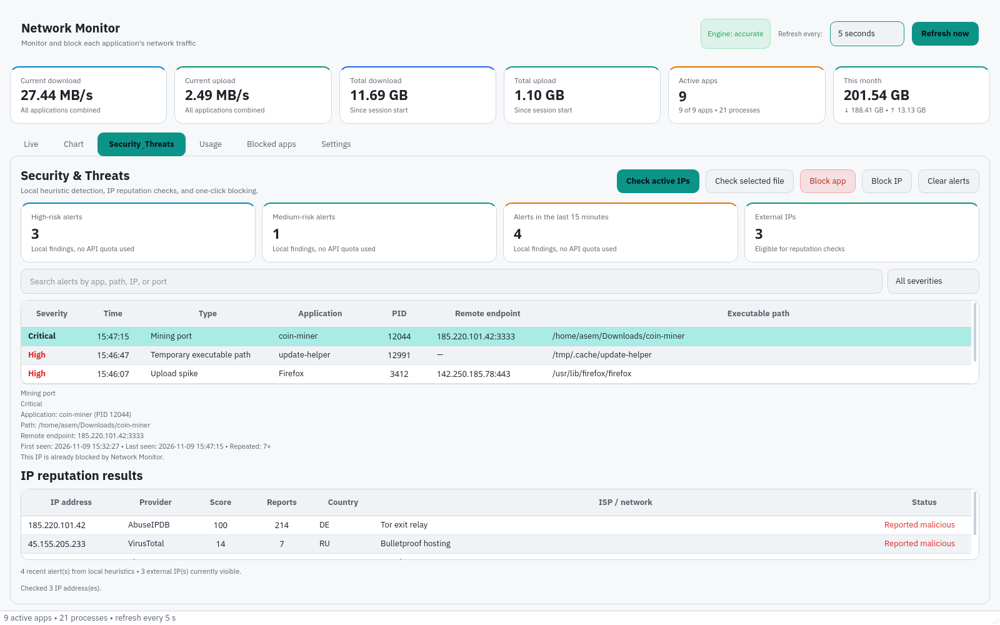
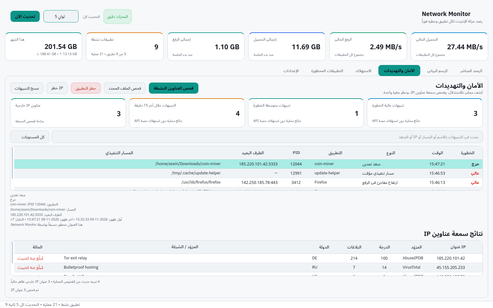
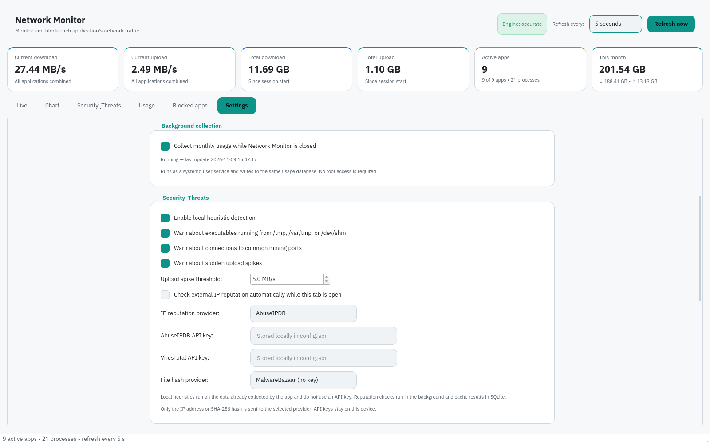
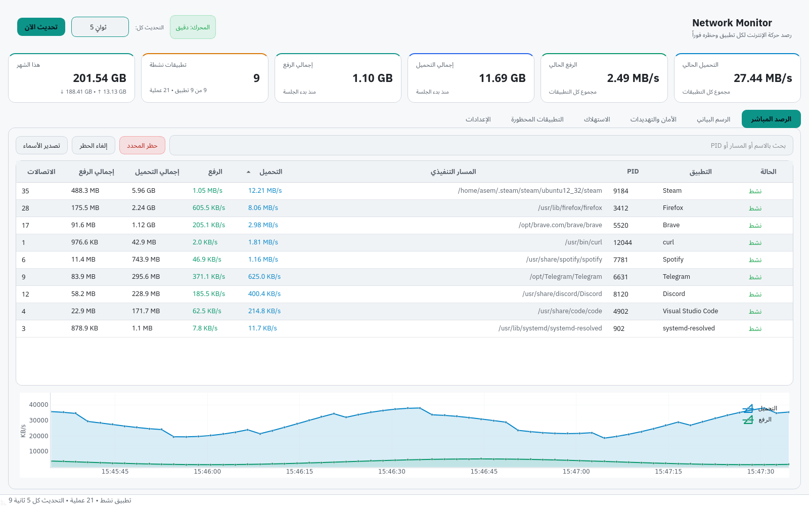
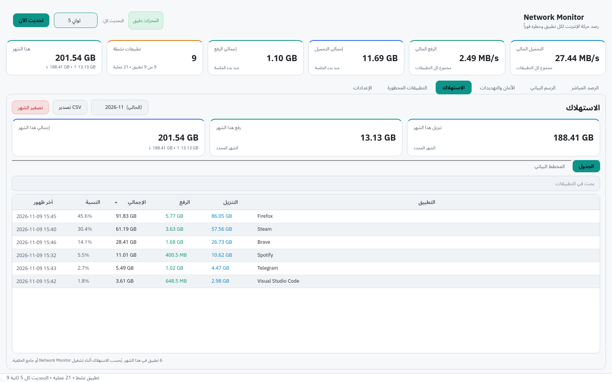

# Network Monitor

A light/dark, bilingual (English/Arabic) desktop network monitor for Linux (Debian/Ubuntu and Fedora) that shows accurate per-application download/upload speed using native Netlink counters, keeps monthly and daily usage statistics, and lets you block any application with cgroup v2 + nftables.

## Features
- Native Netlink per-socket counters through `pyroute2`, with an automatic `ss` fallback and a final `/proc/net` discovery mode that clearly says when byte counters are unavailable.
- Live per-process download and upload rates (KB/s–MB/s), active connections, full executable paths, CPU, and RSS.
- Monthly and daily usage per application, with separate Table and Chart tabs, a searchable usage table, and CSV export.
- Optional background collector that keeps monthly and daily usage updated while the app is closed, using a systemd user service with single-writer SQLite coordination.
- Optional cgroup grouping for Flatpak, Snap, and AppImage applications so multi-process apps appear as one row.
- Session totals, current-month card, and an interactive time-series chart.
- Search, sortable columns, and hide-idle filter.
- Export visible application names to a text file.
- Real block/unblock via cgroup v2 + nftables with polkit authentication.
- Persistent blocklist with import/export and apply-on-start.
- Diagnostics panel with copy-to-clipboard, showing the active engine, socket attribution, and why counters may be limited.
- Signed in-app updates from Settings for manual `/opt` installs, AppImage, `.deb`, `.rpm`, and Flatpak, with checksum and GPG verification plus backup/rollback for manual installs. Official distribution packages defer to the distribution package manager instead of replacing themselves.
- Security & Threats tab with local heuristics (temporary executable paths, common mining ports, upload spikes), asynchronous AbuseIPDB/VirusTotal IP reputation checks with SQLite caching, on-demand SHA-256 file checks through MalwareBazaar/VirusTotal, and one-click app/IP blocking through the existing cgroup v2 + nftables helper.
- English and Arabic interfaces with instant switching in Settings (English is the default), full RTL support, light/dark themes that follow the system by default, tray icon, optional start-with-system, and desktop integration.

## New in 1.1.0

- Added the **Security & Threats** tab with local heuristics for temporary executable paths, common mining ports, and upload spikes.
- Added asynchronous AbuseIPDB and VirusTotal IP reputation checks with a local SQLite cache, optional automatic checks, and clear API-key fields in Settings. API keys stay on the machine and are only sent to the selected provider.
- Added on-demand SHA-256 file checks through MalwareBazaar and VirusTotal, with cached results and a details panel.
- Added confirmed remote-IP blocking and unblocking through the existing polkit-authenticated cgroup v2 + nftables helper.
- Extended connection discovery to retain local and remote endpoints, so the Security tab can match findings to the right process and destination.
- Added English/Arabic strings, RTL-aware tables and filters, theming, filters, context menus, and unit tests for the security engine and cache.
- Added a refreshed visual gallery, AppStream screenshots, and updated release documentation for 1.1.0.

See [docs/RELEASE_NOTES_v1.1.0.md](docs/RELEASE_NOTES_v1.1.0.md) for details.
Previous release: [docs/RELEASE_NOTES_v1.0.9.md](docs/RELEASE_NOTES_v1.0.9.md).

## A visual tour of 1.1.0

These screenshots come from the real 1.1.0 interface with realistic sample
data. No real user traffic, API keys, or machine identifiers are shown.

| Screenshot | What it shows |
| --- | --- |
|  | **Live activity — see who is using your connection.** The top cards summarize current download/upload, session totals, active apps, and the month. Each row is an app with its PID, executable path, live rates, totals, and connection count; the chart underneath turns the last two minutes into a story. |
|  | **Connections at a glance.** Sort by the Connections column to find the app opening the most sockets. Steam leads with 35, followed by Firefox and Brave. Select a row to use **Block selected**, **Unblock**, or **Export names**. |
|  | **Traffic chart — the shape of your network.** Download (blue) and upload (green) are plotted in KB/s on a real time axis. The legend, grid, and moving window make spikes and quiet periods obvious. |
|  | **Monthly usage — who really consumed the data.** This month's totals sit above a searchable table. Every app shows download, upload, total, share of the month, and last-seen time; **Export CSV** turns the view into a spreadsheet. |
|  | **Daily usage chart — spot the heavy days.** The chart compares daily download and upload totals for the selected month, so a backup, game update, or video binge is easy to identify. |
|  | **Security & Threats — local signals first.** The cards count high/medium alerts, recent alerts, and external IPs. The table links severity, time, finding type, app, PID, remote endpoint, and executable path; selecting a row opens the evidence panel and the IP reputation table below. |
|  | **The same security view in Arabic.** Tables, filters, tooltips, and the details panel switch to RTL without losing the column meaning or the severity colors. |
|  | **Blocked apps — the list and the controls.** Every blocked application shows its executable path, when it was added, and its stable ID. **Apply now** re-creates the cgroup/nftables rules; **Unblock selected**, **Export list**, and **Import list** keep the list portable. |
|  | **Settings that fit your workflow.** Choose language, light/dark theme, refresh interval, idle-process visibility, session totals, usage retention, cgroup grouping, start-with-system, tray behavior, and the optional background collector. |
|  | **Security controls in one place.** Enable or tune local heuristics, set the upload-spike threshold, choose optional automatic IP checks, pick AbuseIPDB/VirusTotal, and enter your own API keys. The hint reminds you that only the selected IP or SHA-256 leaves the device. |
|  | **Updates, diagnostics, and About.** The updater verifies signed checksums before installing; Diagnostics explains the active engine, socket attribution, and fallbacks; About shows the installed version and local paths. |
|  | **Live activity in Arabic.** The entire window flips to RTL: cards, table headers, rates, paths, and the status bar keep their meaning while the layout reads naturally from right to left. |
|  | **Usage in Arabic.** Monthly cards, the search field, table columns, CSV export, and the reset action are all localized; numbers and dates stay readable inside the RTL layout. |

## Download
Prebuilt packages are published on **GitHub Releases**:

<https://github.com/AsemShahen/NetworkMonitor/releases>

- **Debian/Ubuntu:** `network-monitor_<version>_amd64.deb`
- **Fedora/RHEL:** `network-monitor-<version>-1.x86_64.rpm`
- **Manual `/opt` updates:** `NetworkMonitor-<version>-linux-x86_64.tar.gz`
- **Portable:** `NetworkMonitor-<version>-x86_64.AppImage`
- **AppImage updates:** `NetworkMonitor-<version>-x86_64.AppImage.zsync`
- **Checksums:** `SHA256SUMS` and its detached signature `SHA256SUMS.asc`

The `.deb` and `.rpm` packages install the privileged helper and the polkit policy. The AppImage contains the helper, but blocking still requires host `pkexec`, `python3`, `nftables`, and cgroup v2. The AppImage embeds `gh-releases-zsync` update information, so AppImageUpdate can use the published `.zsync` file for delta updates.

## Install from the signed package repository

The signed repository is available at <https://asemshahen.github.io/NetworkMonitor/>. Install and update Network Monitor with your package manager. The repository is signed with GPG; the public key and fingerprint are published there.

### Debian / Ubuntu
```bash
sudo install -d -m 0755 /etc/apt/keyrings
curl -fsSL https://asemshahen.github.io/NetworkMonitor/keys/network-monitor.asc \
  | sudo gpg --dearmor --yes -o /etc/apt/keyrings/network-monitor.gpg
echo "deb [signed-by=/etc/apt/keyrings/network-monitor.gpg] https://asemshahen.github.io/NetworkMonitor/apt stable main" \
  | sudo tee /etc/apt/sources.list.d/network-monitor.list
sudo apt update
sudo apt install network-monitor
```

### Fedora / RHEL
```bash
sudo curl -fsSL https://asemshahen.github.io/NetworkMonitor/rpm/network-monitor.repo \
  -o /etc/yum.repos.d/network-monitor.repo
sudo dnf install network-monitor
```

Maintainers can find the repository setup in [docs/REPOSITORIES.md](docs/REPOSITORIES.md).

## Quick start
```bash
./network-monitor
```

## Install system-wide
```bash
./install.sh
network-monitor
```
See [docs/INSTALL.md](docs/INSTALL.md) for all package and source install
methods, and `docs/INSTALL_AR.md` and `docs/FIRST_RUN_AR.md` (Arabic).

## Build packages
The release workflow builds all three formats on every `v*` tag. To build locally:

```bash
./packaging/build-runtime.sh
./packaging/build-deb.sh
./packaging/build-rpm.sh
./packaging/build-appimage.sh
```

Output is written to `build/`. See `packaging/README_AR.md` for details and required tools.

## Requirements
- Linux with cgroup v2 and glibc 2.34 or newer (the bundled Qt/PySide6 runtime requires it).
- `pyroute2` for native Netlink counters. It is bundled in the release packages; source installs need `python3 -m pip install pyroute2`.
- `iproute2` (`ss`) is an optional fallback and is recommended. Without Netlink or `ss`, the app still discovers connections from `/proc/net` but cannot show byte counters.
- `nftables` + `polkit` (`pkexec`) for blocking.
- The app runtime (Python, PySide6, pyqtgraph, numpy, pyroute2) is bundled in the release packages; the privileged helper uses the system `python3`.
- Monthly usage is counted while Network Monitor is running, or continuously when the optional background collector is enabled. UDP/QUIC sockets have no reliable kernel byte counters, so they are shown as “speed unavailable” instead of a misleading `0 B/s`.

## Tests
```bash
./packaging/build-runtime.sh
PYTHONPATH=src build/runtime/bin/python3 -m unittest discover -s tests -v
```

## Author
**Author:** AL-Asem Software By Asem Shahen And DeepSeek V4.1 Flash Free

**Email:** <asemshahen5@gmail.com>

## License
GPL-3.0-or-later. See [LICENSE](LICENSE).
