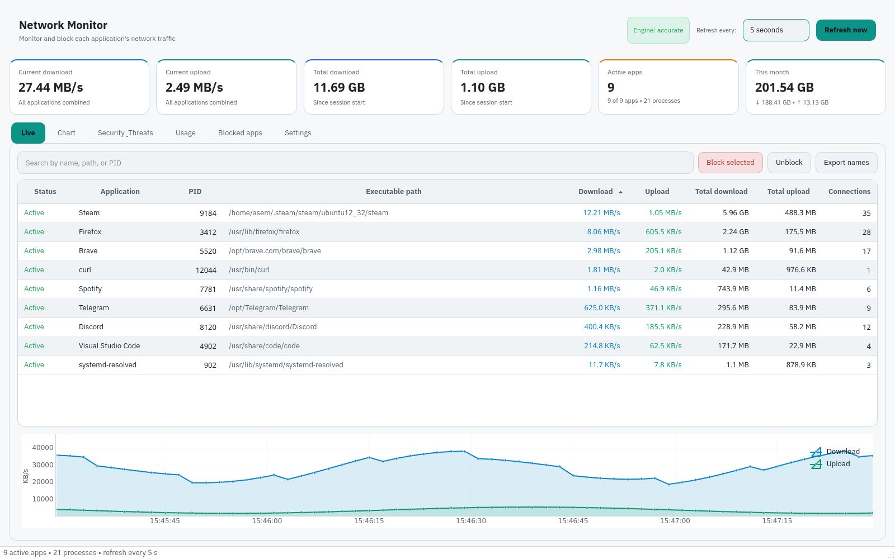
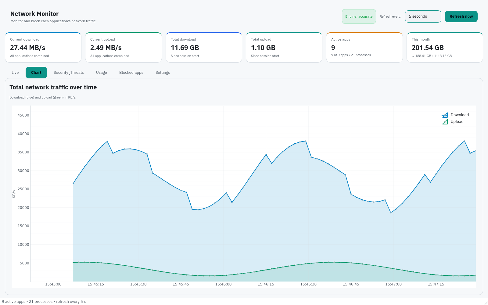
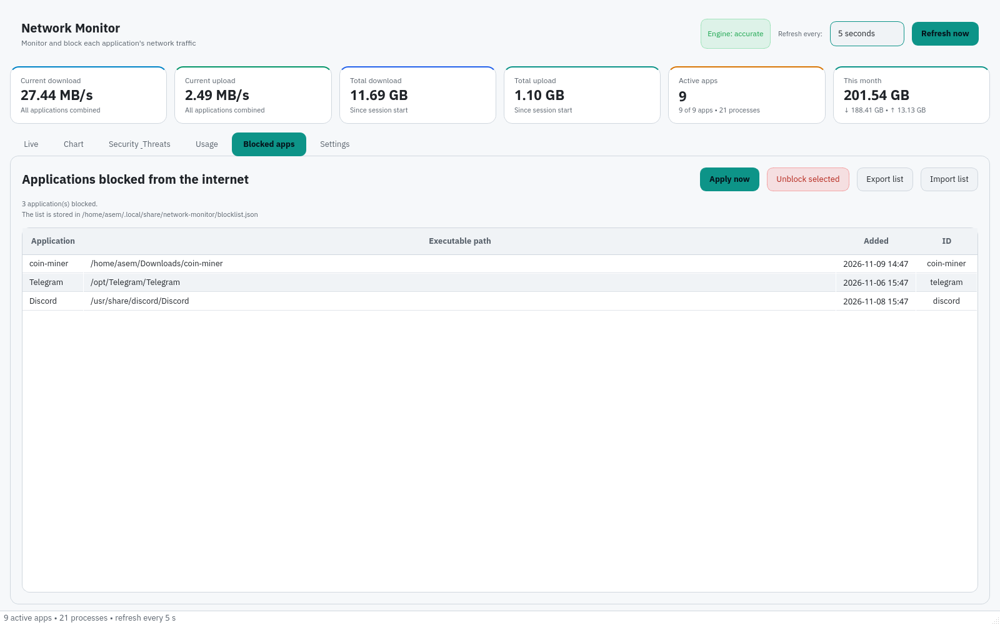
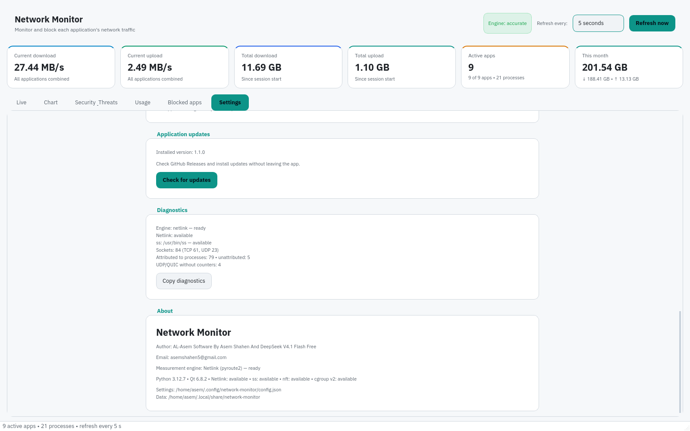
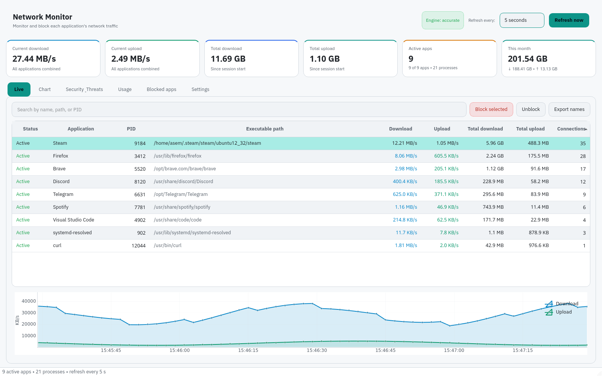
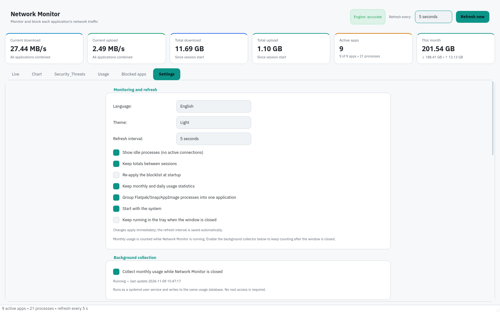

# Network Monitor

A light/dark, bilingual (English/Arabic) desktop network monitor for Linux (Debian/Ubuntu and Fedora) that shows accurate per-application download/upload speed using native Netlink counters, keeps monthly and daily usage statistics, and lets you block any application with cgroup v2 + nftables.

## Features
- Native Netlink per-socket counters through `pyroute2`, with an automatic `ss` fallback and a final `/proc/net` discovery mode that clearly says when byte counters are unavailable.
- Live per-process download and upload rates (KB/s–MB/s), active connections, full executable paths, CPU, and RSS.
- Monthly and daily usage per application, a daily download/upload chart, a searchable usage table, and CSV export.
- Optional cgroup grouping for Flatpak, Snap, and AppImage applications so multi-process apps appear as one row.
- Session totals, current-month card, and an interactive time-series chart.
- Search, sortable columns, and hide-idle filter.
- Export visible application names to a text file.
- Real block/unblock via cgroup v2 + nftables with polkit authentication.
- Persistent blocklist with import/export and apply-on-start.
- Diagnostics panel with copy-to-clipboard, showing the active engine, socket attribution, and why counters may be limited.
- English and Arabic interfaces with instant switching in Settings (English is the default), full RTL support, light/dark themes that follow the system by default, tray icon, optional start-with-system, and desktop integration.

## New in 1.0.5

- Replaced the `ss`-only measurement path with native Netlink (`NETLINK_SOCK_DIAG`) as the primary engine. This fixes applications such as LM Studio Flatpak that were visible in `ss` but fell back to `/proc/net` with no counters.
- Added per-inode deltas, so closing one socket and opening another does not double-count or lose bytes.
- Added monthly/daily SQLite usage storage, the Usage tab, chart, and CSV export.
- Added diagnostics, Flatpak/Snap/AppImage grouping, recent-activity retention, and clear UDP/QUIC “speed unavailable” labels.
- Added tray usage access, real tray quit behavior, `--hidden` startup, and optional autostart.

See [docs/RELEASE_NOTES_v1.0.5.md](docs/RELEASE_NOTES_v1.0.5.md) for details.

## Screenshots

| Live activity | Traffic chart |
| --- | --- |
|  |  |

| Blocked applications | Settings and About |
| --- | --- |
|  |  |

| Live connections | Settings |
| --- | --- |
|  |  |

## Download
Prebuilt packages are published on **GitHub Releases**:

<https://github.com/AsemShahen/NetworkMonitor/releases>

- **Debian/Ubuntu:** `network-monitor_<version>_amd64.deb`
- **Fedora/RHEL:** `network-monitor-<version>-1.x86_64.rpm`
- **Portable:** `NetworkMonitor-<version>-x86_64.AppImage`
- **AppImage updates:** `NetworkMonitor-<version>-x86_64.AppImage.zsync`
- **Checksums:** `SHA256SUMS` and its detached signature `SHA256SUMS.asc`

The `.deb` and `.rpm` packages install the privileged helper and the polkit policy. The AppImage contains the helper, but blocking still requires host `pkexec`, `python3`, `nftables`, and cgroup v2. The AppImage embeds `gh-releases-zsync` update information, so AppImageUpdate can use the published `.zsync` file for delta updates.

## Install from the signed package repository

The signed repository is available at <https://asemshahen.github.io/NetworkMonitor/>. Install and update Network Monitor with your package manager. The repository is signed with GPG; the public key and fingerprint are published there.

### Debian / Ubuntu
```bash
sudo install -d -m 0755 /etc/apt/keyrings
curl -fsSL https://asemshahen.github.io/NetworkMonitor/keys/network-monitor.asc \
  | sudo gpg --dearmor --yes -o /etc/apt/keyrings/network-monitor.gpg
echo "deb [signed-by=/etc/apt/keyrings/network-monitor.gpg] https://asemshahen.github.io/NetworkMonitor/apt stable main" \
  | sudo tee /etc/apt/sources.list.d/network-monitor.list
sudo apt update
sudo apt install network-monitor
```

### Fedora / RHEL
```bash
sudo curl -fsSL https://asemshahen.github.io/NetworkMonitor/rpm/network-monitor.repo \
  -o /etc/yum.repos.d/network-monitor.repo
sudo dnf install network-monitor
```

Maintainers can find the repository setup in [docs/REPOSITORIES.md](docs/REPOSITORIES.md).

## Quick start
```bash
./network-monitor
```

## Install system-wide
```bash
./install.sh
network-monitor
```
See [docs/INSTALL.md](docs/INSTALL.md) for all package and source install
methods, and `docs/INSTALL_AR.md` and `docs/FIRST_RUN_AR.md` (Arabic).

## Build packages
The release workflow builds all three formats on every `v*` tag. To build locally:

```bash
./packaging/build-runtime.sh
./packaging/build-deb.sh
./packaging/build-rpm.sh
./packaging/build-appimage.sh
```

Output is written to `build/`. See `packaging/README_AR.md` for details and required tools.

## Requirements
- Linux with cgroup v2 and glibc 2.34 or newer (the bundled Qt/PySide6 runtime requires it).
- `pyroute2` for native Netlink counters. It is bundled in the release packages; source installs need `python3 -m pip install pyroute2`.
- `iproute2` (`ss`) is an optional fallback and is recommended. Without Netlink or `ss`, the app still discovers connections from `/proc/net` but cannot show byte counters.
- `nftables` + `polkit` (`pkexec`) for blocking.
- The app runtime (Python, PySide6, pyqtgraph, numpy, pyroute2) is bundled in the release packages; the privileged helper uses the system `python3`.
- Monthly usage is counted only while Network Monitor is running. UDP/QUIC sockets have no reliable kernel byte counters, so they are shown as “speed unavailable” instead of a misleading `0 B/s`.

## Tests
```bash
./packaging/build-runtime.sh
PYTHONPATH=src build/runtime/bin/python3 -m unittest discover -s tests -v
```

## Author
**Author:** AL-Asem Software By Asem Shahen And DeepSeek V4.1 Flash Free

**Email:** <asemshahen5@gmail.com>

## License
GPL-3.0-or-later. See [LICENSE](LICENSE).
