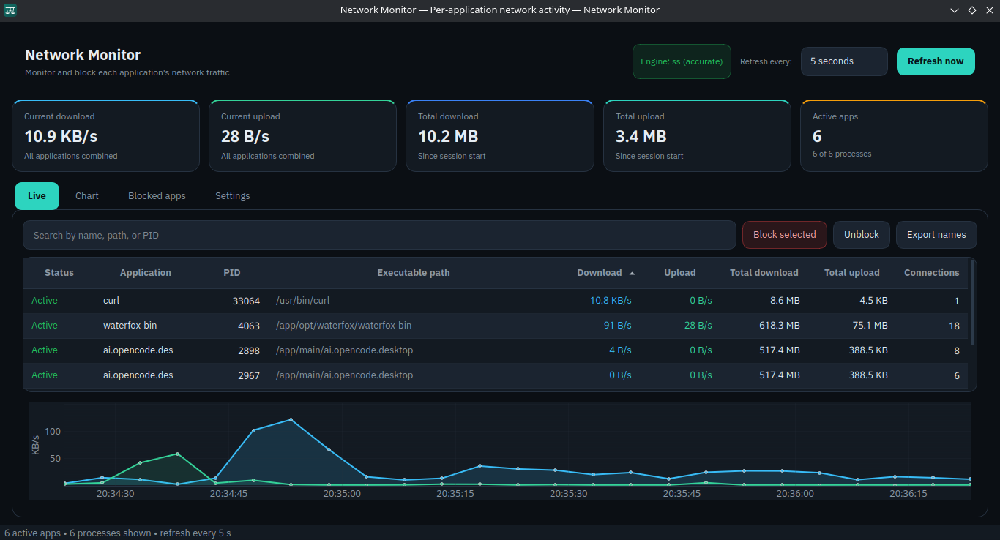
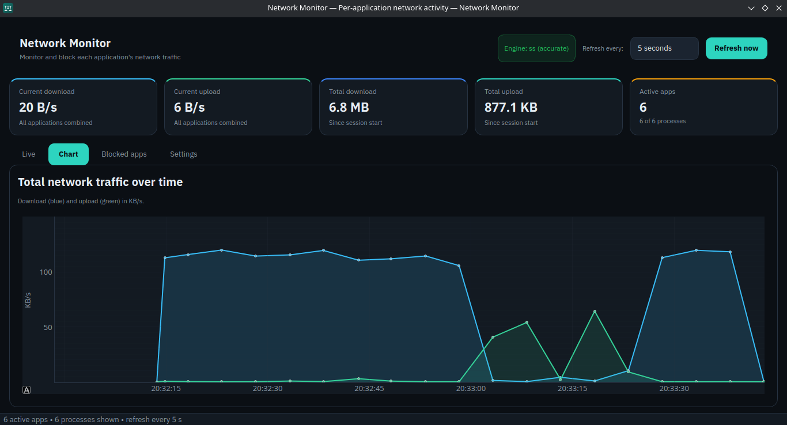
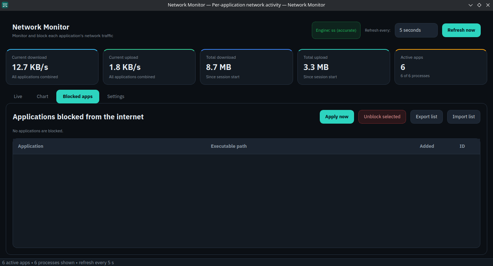
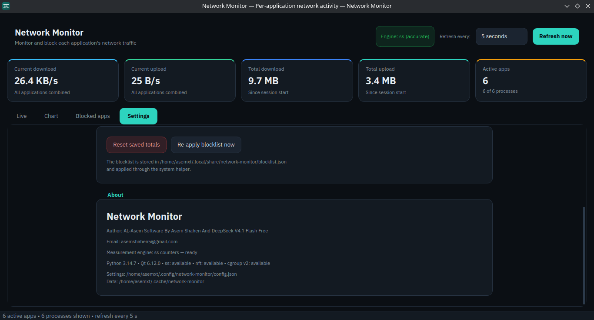
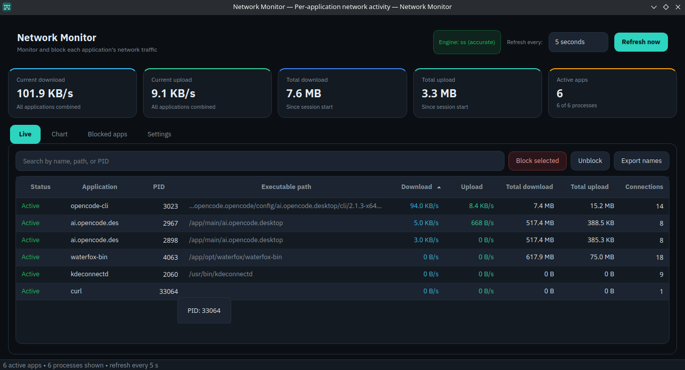
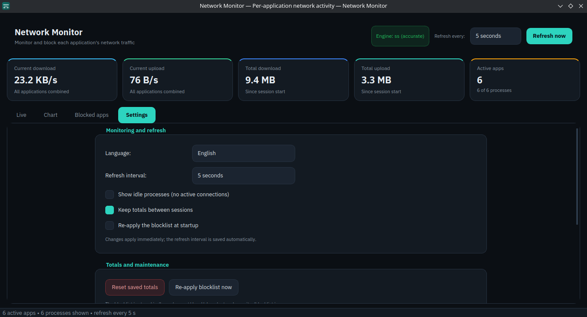

# Network Monitor — مراقب الشبكة

برنامج رسومي مظلم ثنائي اللغة (إنجليزي/عربي) لمراقبة استهلاك الإنترنت لكل تطبيق على Debian/Ubuntu وFedora، مع إمكانية حظر أي تطبيق من الاتصال.

## الميزات
- عرض التطبيقات ذات الاتصالات النشطة مع اسمها ومسارها التنفيذي الكامل.
- سرعة التنزيل والرفع اللحظية لكل تطبيق (KB/s أو MB/s تلقائياً).
- إجماليات الجلسة وبطاقات إحصائية علوية.
- رسم بياني زمني تفاعلي لحركة التنزيل والرفع.
- بحث فوري، وفرز بالأعمدة، وإخفاء العمليات الخاملة.
- تصدير أسماء البرامج إلى ملف نصي.
- حظر/إلغاء حظر التطبيقات فعلياً عبر cgroup v2 + nftables مع مصادقة polkit.
- قائمة حظر دائمة مع استيراد/تصدير، وإعادة تطبيق عند الإقلاع.
- واجهة إنجليزية وعربية مع تبديل فوري من الإعدادات (الإنجليزية هي الافتراضية)، ودعم RTL، وثيم داكن، وأيقونة تطبيق.

## لقطات الشاشة

| النشاط المباشر | الرسم البياني |
| --- | --- |
|  |  |

| التطبيقات المحظورة | الإعدادات وحول البرنامج |
| --- | --- |
|  |  |

| الاتصالات النشطة | الإعدادات |
| --- | --- |
|  |  |

## التحميل
تُنشر الحزم الجاهزة عبر **GitHub Releases**:

<https://github.com/AsemShahen/NetworkMonitor/releases>

- **Debian/Ubuntu:** `network-monitor_<version>_amd64.deb`
- **Fedora/RHEL:** `network-monitor-<version>-1.x86_64.rpm`
- **محمولة:** `NetworkMonitor-<version>-x86_64.AppImage`

حزم `.deb` و`.rpm` تثبّت المساعد المميز وسياسة polkit. أما AppImage فيحوي المساعد داخله، لكن الحظر يحتاج إلى `pkexec` و`python3` و`nftables` وcgroup v2 على النظام المضيف.

## التثبيت من مستودع الحزم الموقّع

المستودع الموقّع متاح على:

<https://asemshahen.github.io/NetworkMonitor/>

يمكن تثبيت Network Monitor وتحديثه عبر مدير الحزم. المستودع موقّع بمفتاح GPG، والمفتاح العام والبصمة منشوران هناك.

### Debian / Ubuntu
```bash
sudo install -d -m 0755 /etc/apt/keyrings
curl -fsSL https://asemshahen.github.io/NetworkMonitor/keys/network-monitor.asc \
  | sudo gpg --dearmor --yes -o /etc/apt/keyrings/network-monitor.gpg
echo "deb [signed-by=/etc/apt/keyrings/network-monitor.gpg] https://asemshahen.github.io/NetworkMonitor/apt stable main" \
  | sudo tee /etc/apt/sources.list.d/network-monitor.list
sudo apt update
sudo apt install network-monitor
```

### Fedora / RHEL
```bash
sudo curl -fsSL https://asemshahen.github.io/NetworkMonitor/rpm/network-monitor.repo \
  -o /etc/yum.repos.d/network-monitor.repo
sudo dnf install network-monitor
```

للمشرفين، خطوات الإعداد في [docs/REPOSITORIES_AR.md](docs/REPOSITORIES_AR.md).

## التشغيل السريع
```bash
./network-monitor
```

## التثبيت على النظام
```bash
./install.sh
network-monitor
```
ثم راجع `docs/INSTALL_AR.md` و`docs/FIRST_RUN_AR.md`.

## بناء الحزم
سير عمل الإصدارات يبني الصيغ الثلاث عند كل وسم `v*`. للبناء محلياً:

```bash
./packaging/build-runtime.sh
./packaging/build-deb.sh
./packaging/build-rpm.sh
./packaging/build-appimage.sh
```

تظهر المخرجات في `build/`. راجع `packaging/README_AR.md` للتفاصيل والأدوات المطلوبة.

## المتطلبات
- النظام: Linux بنواة تدعم cgroup v2 وglibc 2.34 أو أحدث (لأن وقت تشغيل Qt/PySide6 المرفق يتطلب ذلك).
- القياس الدقيق: حزمة `iproute2` (أمر `ss`).
- الحظر: `nftables` + `polkit` (`pkexec`).
- وقت تشغيل التطبيق (Python وPySide6 وpyqtgraph وnumpy) مرفق داخل حزم الإصدار؛ المساعد المميز يستخدم `python3` النظام.

## الاختبارات
```bash
./packaging/build-runtime.sh
PYTHONPATH=src build/runtime/bin/python3 -m unittest discover -s tests -v
```

## المؤلف
**المؤلف:** AL-Asem Software By Asem Shahen And DeepSeek V4.1 Flash Free

**البريد الإلكتروني:** <asemshahen5@gmail.com>

## الترخيص
GPL-3.0-or-later. راجع ملف [LICENSE](LICENSE).
