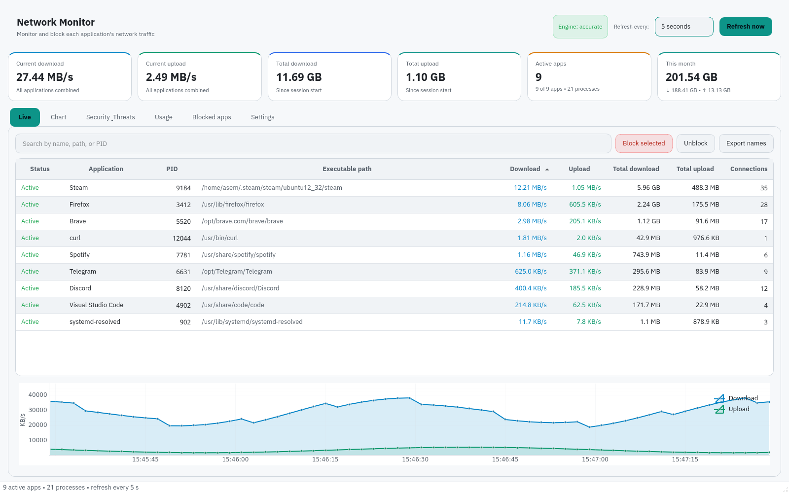
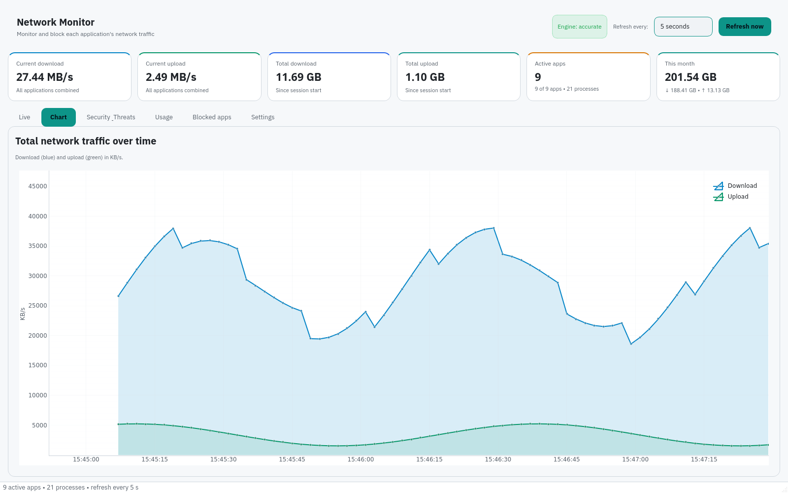
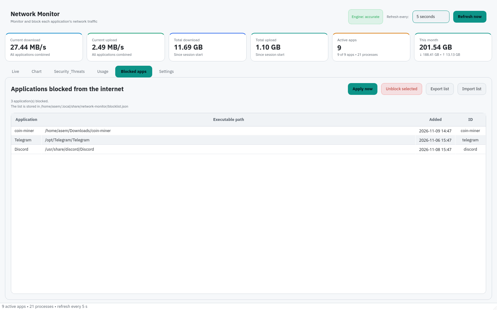
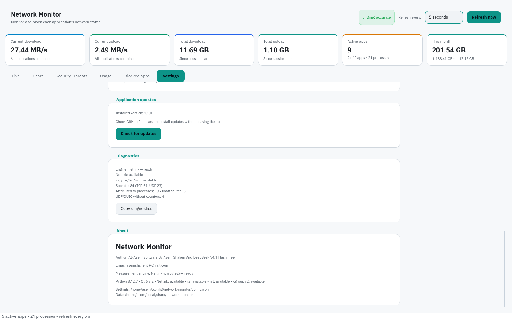
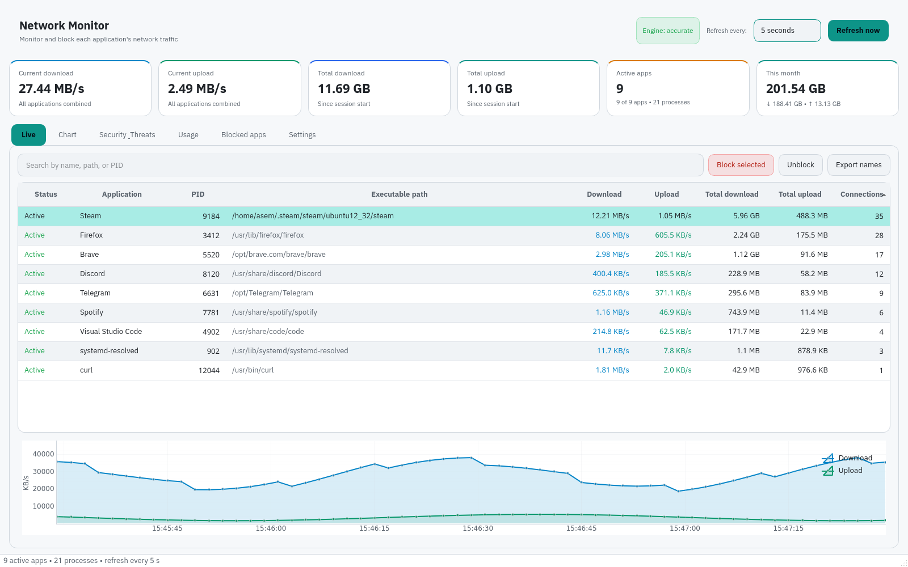
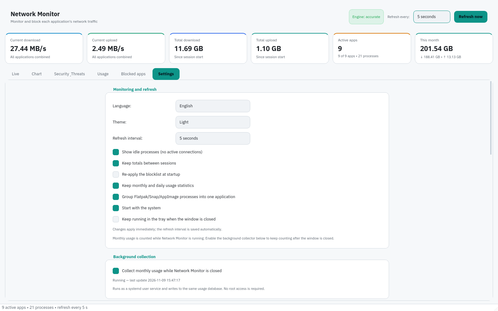
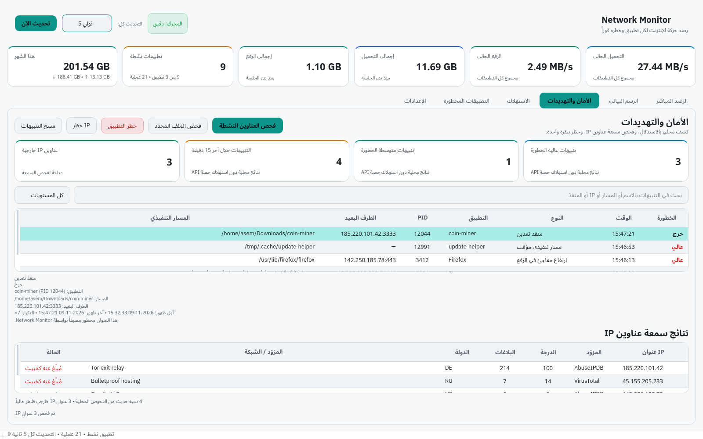
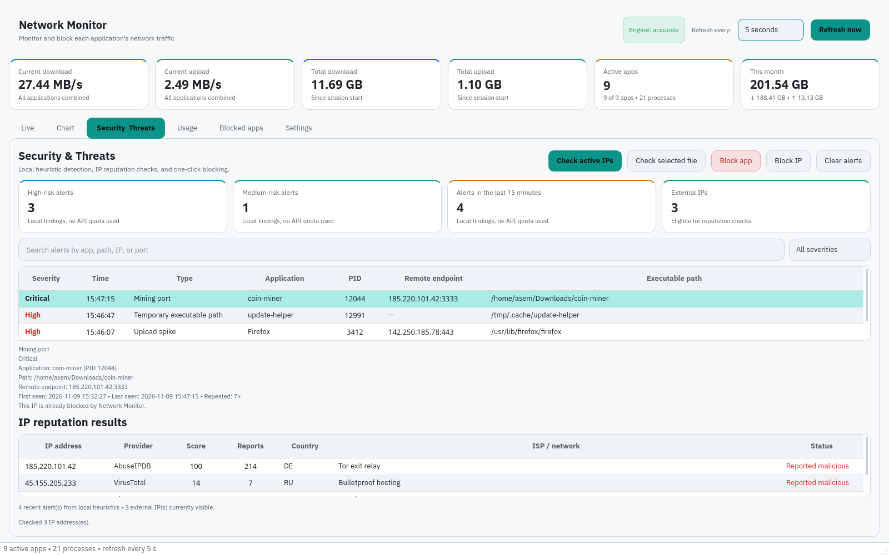

# Network Monitor — مراقب الشبكة

برنامج رسومي ثنائي اللغة (إنجليزي/عربي) لمراقبة استهلاك الإنترنت لكل تطبيق على Debian/Ubuntu وFedora باستخدام عدّادات Netlink الأصلية، مع إحصاءات استهلاك شهرية ويومية، وإمكانية حظر أي تطبيق عبر cgroup v2 + nftables.

## الميزات
- عدّادات Netlink أصلية لكل مقبس عبر `pyroute2`، مع رجوع تلقائي إلى `ss` ثم `/proc/net` مع رسالة واضحة عند غياب العدّادات.
- عرض التطبيقات ذات الاتصالات النشطة مع اسمها ومسارها التنفيذي الكامل، وسرعة التنزيل والرفع اللحظية (KB/s أو MB/s تلقائياً).
- إحصاءات استهلاك شهرية ويومية لكل تطبيق، مع تبويبين منفصلين للجدول والمخطط، وجدول قابل للبحث، وتصدير CSV.
- جامع خلفية اختياري يحدّث الاستهلاك الشهري واليومي أثناء إغلاق التطبيق عبر خدمة مستخدم في systemd مع تنسيق كاتب واحد لقاعدة بيانات SQLite.
- تجميع اختياري لتطبيقات Flatpak وSnap وAppImage في صف واحد لكل تطبيق.
- إجماليات الجلسة، وبطاقة الشهر الحالي، ورسم بياني زمني تفاعلي.
- بحث فوري، وفرز بالأعمدة، وإخفاء العمليات الخاملة.
- تصدير أسماء البرامج إلى ملف نصي.
- حظر/إلغاء حظر التطبيقات فعلياً عبر cgroup v2 + nftables مع مصادقة polkit.
- قائمة حظر دائمة مع استيراد/تصدير، وإعادة تطبيق عند الإقلاع.
- لوحة تشخيص مع نسخ النتائج، تعرض المحرك النشط ونسبة نسب المقابس للعمليات وسبب محدودية العدّادات.
- تحديثات موقّعة من داخل الإعدادات للتثبيت اليدوي في `/opt` وAppImage و`.deb` و`.rpm` وFlatpak، مع التحقق من البصمة وتوقيع GPG ونسخة احتياطية واسترجاع تلقائي للتثبيت اليدوي. أما حزم التوزيعات الرسمية فتحوّل التحديث إلى مدير الحزم بدل استبدال نفسها.
- تبويب **الأمان والتهديدات** مع فحص محلي للمسارات التنفيذية المؤقتة ومنافذ التعدين الشائعة وارتفاعات الرفع المفاجئة.
- فحص غير متزامن لسمعة عناوين IP عبر AbuseIPDB وVirusTotal مع ذاكرة SQLite محلية، وفحص تلقائي اختياري، وحقول واضحة لمفاتيح API في الإعدادات. تبقى المفاتيح على الجهاز ولا تُرسل إلا إلى المزوّد المختار.
- فحص SHA-256 عند الطلب للملفات عبر MalwareBazaar وVirusTotal، مع نتائج مخزّنة ولوحة تفاصيل.
- حظر وإلغاء حظر عناوين IP البعيدة بعد التأكيد عبر مساعد cgroup v2 + nftables المحمي بـpolkit.
- توسيع اكتشاف الاتصالات للاحتفاظ بالعنوان المحلي والبعيد، ليطابق تبويب الأمان النتائج مع العملية والوجهة الصحيحتين.
- إضافة نصوص إنجليزية وعربية، وجداول ومرشحات تراعي RTL، وثيمات، ومرشحات، وقوائم سياق، واختبارات لمحرك الأمان والذاكرة.
- إضافة لقطة شاشة للأمان وتحديث بيانات AppStream وصفحة الدليل ووثائق الإصدار.
- واجهة إنجليزية وعربية مع تبديل فوري من الإعدادات (الإنجليزية هي الافتراضية)، ودعم RTL، وثيم يتبع النظام افتراضياً، وأيقونة تطبيق، وتشغيل تلقائي اختياري.

## الجديد في 1.1.0

- أُضيف تبويب **الأمان والتهديدات** مع فحص محلي للمسارات التنفيذية المؤقتة ومنافذ التعدين الشائعة وارتفاعات الرفع المفاجئة.
- أُضيف فحص غير متزامن لسمعة عناوين IP عبر AbuseIPDB وVirusTotal مع ذاكرة SQLite محلية، وفحص تلقائي اختياري، وحقول مفاتيح API في الإعدادات.
- أُضيف فحص SHA-256 عند الطلب للملفات عبر MalwareBazaar وVirusTotal، مع نتائج مخزّنة ولوحة تفاصيل.
- أُضيف حظر وإلغاء حظر عناوين IP البعيدة بعد التأكيد عبر مساعد cgroup v2 + nftables المحمي بـpolkit.
- أُضيفت نصوص إنجليزية وعربية، وجداول ومرشحات تراعي RTL، وثيمات، وقوائم سياق، واختبارات لمحرك الأمان والذاكرة.
- أُضيفت لقطة شاشة للأمان وحُدّثت بيانات AppStream وصفحة الدليل ووثائق الإصدار.
- يظل تغليف Debian وFedora الرسمي جاهزًا في شجرة المصدر؛ حزمة المصدر الحالية على Mentors هي `1.0.9-3` وتنتظر راعيًا، وطلب مراجعة Fedora `2568606` ينتظر مراجعًا.

راجع [docs/RELEASE_NOTES_v1.1.0.md](docs/RELEASE_NOTES_v1.1.0.md) للتفاصيل.
الإصدار السابق: [docs/RELEASE_NOTES_v1.0.9.md](docs/RELEASE_NOTES_v1.0.9.md).

## لقطات الشاشة

| النشاط المباشر | الرسم البياني |
| --- | --- |
|  |  |

| التطبيقات المحظورة | الإعدادات وحول البرنامج |
| --- | --- |
|  |  |

| الاتصالات النشطة | الإعدادات |
| --- | --- |
|  |  |

| الأمان والتهديدات (العربية) | Security & Threats (English) |
| --- | --- |
|  |  |

## التحميل
تُنشر الحزم الجاهزة عبر **GitHub Releases**:

<https://github.com/AsemShahen/NetworkMonitor/releases>

- **Debian/Ubuntu:** `network-monitor_<version>_amd64.deb`
- **Fedora/RHEL:** `network-monitor-<version>-1.x86_64.rpm`
- **التحديث اليدوي في `/opt`:** `NetworkMonitor-<version>-linux-x86_64.tar.gz`
- **محمولة:** `NetworkMonitor-<version>-x86_64.AppImage`
- **بصمات التحقق:** `SHA256SUMS` وتوقيعها المنفصل `SHA256SUMS.asc`

حزم `.deb` و`.rpm` تثبّت المساعد المميز وسياسة polkit. أما AppImage فيحوي المساعد داخله، لكن الحظر يحتاج إلى `pkexec` و`python3` و`nftables` وcgroup v2 على النظام المضيف.

## التثبيت من مستودع الحزم الموقّع

المستودع الموقّع متاح على:

<https://asemshahen.github.io/NetworkMonitor/>

يمكن تثبيت Network Monitor وتحديثه عبر مدير الحزم. المستودع موقّع بمفتاح GPG، والمفتاح العام والبصمة منشوران هناك.

### Debian / Ubuntu
```bash
sudo install -d -m 0755 /etc/apt/keyrings
curl -fsSL https://asemshahen.github.io/NetworkMonitor/keys/network-monitor.asc \
  | sudo gpg --dearmor --yes -o /etc/apt/keyrings/network-monitor.gpg
echo "deb [signed-by=/etc/apt/keyrings/network-monitor.gpg] https://asemshahen.github.io/NetworkMonitor/apt stable main" \
  | sudo tee /etc/apt/sources.list.d/network-monitor.list
sudo apt update
sudo apt install network-monitor
```

### Fedora / RHEL
```bash
sudo curl -fsSL https://asemshahen.github.io/NetworkMonitor/rpm/network-monitor.repo \
  -o /etc/yum.repos.d/network-monitor.repo
sudo dnf install network-monitor
```

للمشرفين، خطوات الإعداد في [docs/REPOSITORIES_AR.md](docs/REPOSITORIES_AR.md).

## التشغيل السريع
```bash
./network-monitor
```

## التثبيت على النظام
```bash
./install.sh
network-monitor
```
ثم راجع `docs/INSTALL_AR.md` و`docs/FIRST_RUN_AR.md`.

## بناء الحزم
سير عمل الإصدارات يبني الصيغ الثلاث عند كل وسم `v*`. للبناء محلياً:

```bash
./packaging/build-runtime.sh
./packaging/build-deb.sh
./packaging/build-rpm.sh
./packaging/build-appimage.sh
```

تظهر المخرجات في `build/`. راجع `packaging/README_AR.md` للتفاصيل والأدوات المطلوبة.

## المتطلبات
- النظام: Linux بنواة تدعم cgroup v2 وglibc 2.34 أو أحدث (لأن وقت تشغيل Qt/PySide6 المرفق يتطلب ذلك).
- `pyroute2` لعدّادات Netlink. مرفق داخل حزم الإصدار؛ وعند التثبيت من المصدر ثبّته بالأمر `python3 -m pip install pyroute2`.
- `iproute2` (أمر `ss`) رجوع اختياري ويُوصى به. عند غياب Netlink و`ss` يكتشف البرنامج الاتصالات من `/proc/net` فقط دون عدّادات بايت.
- الحظر: `nftables` + `polkit` (`pkexec`).
- وقت تشغيل التطبيق (Python وPySide6 وpyqtgraph وnumpy وpyroute2) مرفق داخل حزم الإصدار؛ المساعد المميز يستخدم `python3` النظام.
- يُحسب الاستهلاك الشهري فقط أثناء تشغيل Network Monitor. مقابس UDP/QUIC لا توفر عدّادات بايت موثوقة، لذلك تظهر «السرعة غير متاحة» بدل `0 B/s` المضلل.

## الاختبارات
```bash
./packaging/build-runtime.sh
PYTHONPATH=src build/runtime/bin/python3 -m unittest discover -s tests -v
```

## المؤلف
**المؤلف:** AL-Asem Software By Asem Shahen And DeepSeek V4.1 Flash Free

**البريد الإلكتروني:** <asemshahen5@gmail.com>

## الترخيص
GPL-3.0-or-later. راجع ملف [LICENSE](LICENSE).
